<p align="center">
  
</p>

<p align="center">
  <a href="https://normansrule.github.io/Bulwark-Cybersecurity/"><b>▶ Open the live site</b></a> ·
  <a href="#progress-tracker">Progress</a> ·
  <a href="#the-road-to-a-real-platform">Roadmap</a> ·
  <a href="docs/ETHICS.md">Ethics</a> ·
  <a href="CONTRIBUTING.md">Contribute</a>
</p>

<p align="center">
  <a href="https://github.com/Normansrule/Bulwark-Cybersecurity/actions/workflows/ci.yml"></a>
  <a href="https://github.com/Normansrule/Bulwark-Cybersecurity/actions/workflows/codeql.yml"></a>
  <a href="https://github.com/Normansrule/Bulwark-Cybersecurity/actions/workflows/secrets.yml"></a>
  <a href="LICENSE"></a>
  
  
</p>

**Bulwark is an open-source, defensive cybersecurity learning platform.** It teaches security from zero across its whole arc, from the classical ciphers and how each one fell, through the cryptography and APIs running the internet today, to the post-quantum frontier. Every idea is interactive, every claim is cited, and every hands-on attack runs only against a target built into the page, followed by the defense.

It's a **fully static site**: no backend, no build step, no runtime dependencies, no analytics. Nothing you type leaves your browser.

<p align="center">
  
</p>

---

## Progress tracker

<p align="center">
  
</p>

Both the bars above and the checklist below are generated from the repository itself (lesson counts from `js/content.js`, workflow files on disk). To update them after adding content or finishing a step, flip the step in `docs/readme/generate.mjs` and run `node docs/readme/generate.mjs`.

<!-- tracker:start -->
<!-- generated by docs/readme/generate.mjs; edit the AREAS list there, not here -->
- **Curriculum (lessons)** — 68% (27 / 40 lessons)
- **Interactive widgets** — 85% (34 / 40 widgets)
- **CTF challenges** — 63% (19 / 30 challenges)
- **Docs, CI & supply chain** — 100% (7 / 7 steps)
  - [x] README, CONTRIBUTING, ETHICS, SECURITY
  - [x] Lab design + deploy guide
  - [x] CI tests + smoke test + ethics tripwire
  - [x] Actions pinned by SHA + Dependabot
  - [x] CodeQL scanning
  - [x] gitleaks secret scanning
  - [x] Weekly link check
- **Public launch** — 0% (0 / 4 steps)
  - [ ] Create the GitHub repo and push main
  - [ ] Enable GitHub Pages
  - [ ] Turn on secret scanning + push protection
  - [ ] First CI run green on GitHub
- **Sandboxed lab runner** — 20% (1 / 5 steps) · _needs a real host, can't be static_
  - [x] Lab-track design (docs/LABS.md)
  - [ ] Container image per lab, no outbound network
  - [ ] Runner that refuses any target it didn't start
  - [ ] First lab: SQL injection, graded by the fix
  - [ ] Memory-safety lab under a sanitizer
- **Desktop app** — 0% (0 / 4 steps) · _needs a real host, can't be static_
  - [ ] Pick the shell (Tauri or Electron)
  - [ ] Offline lessons packaged
  - [ ] Local lab runner bundled
  - [ ] Signed releases + SHA-256 checksums + SBOM
<!-- tracker:end -->

---

## The road to a real platform

<p align="center">
  
</p>

| Step | What it takes | Status |
|---|---|---|
| **1. Static curriculum** | Lessons, widgets, challenges, glossary, sources, path map | ✅ Done |
| **2. Public-release prep** | SHA-pinned Actions, CodeQL, gitleaks, Dependabot, link check, CONTRIBUTING | ✅ Done |
| **3. Publish** | Create the repo, push `main`, enable GitHub Pages, turn on push protection ([`docs/DEPLOY.md`](docs/DEPLOY.md)) | 🟡 Next |
| **4. Grow the static site** | More walkthroughs, per-category API lessons, community contributions | 🔵 Ongoing |
| **5. Sandboxed lab runner** | Real vulnerable targets in containers with no outbound network, graded by the fix ([`docs/LABS.md`](docs/LABS.md)) | 🟥 Needs a host |
| **6. Desktop app** | Tauri/Electron shell, offline lessons, the local lab runner, signed releases + SBOM | 🟥 Needs a host |

Steps 5 and 6 can't live in a static site: running a deliberately vulnerable target safely needs operating-system isolation, so they need a backend or a desktop app.

---

## The curriculum

<p align="center">
  
</p>

<!-- lessons:start -->
<!-- generated by docs/readme/generate.mjs from js/content.js -->
| Era | Lessons |
|---|---|
| **01 · Foundations** | Classical ciphers, and how they broke · Steganography: hiding in plain sight |
| **02 · Core concepts** | The CIA triad and the shape of defense · Threat modeling: finding the flaws before you build |
| **03 · Live cryptography** | Hashing and the avalanche effect · Public-key cryptography · TLS 1.3: how a secure connection is built · HSTS and Certificate Transparency |
| **04 · Applied security** | Injection: when data becomes code · Cross-site request forgery and SameSite cookies · Clickjacking and frame-ancestors · Session fixation and open redirects · The OWASP Top 10 (2025) · Authentication: passwords, entropy, and passkeys · Storing secrets so a breach isn't a catastrophe · Tokens, sessions, and OAuth · Securing AI systems · Software supply-chain security |
| **05 · API security** | API security: every endpoint is a front door · Secure code review: find it before an attacker does · Automated and AI pentesters: testing your own app |
| **06 · Detection & response** | Port scanning and attack surface · Availability under attack: DDoS, defensively · Detection and response: assume breach |
| **07 · Frontier** | The post-quantum frontier · Quantum cryptography · Zero trust and confidential computing |
<!-- lessons:end -->

### How a lesson feels

- **Step-by-step walkthroughs** in the spirit of [Hacksplaining](https://www.hacksplaining.com/): watch an attack unfold panel by panel, then flip to the defense (CSRF, clickjacking, session fixation, open redirects, SSL stripping, rogue certificates).
- **Real cryptography in the browser** via Web Crypto: SHA-256 avalanche, PBKDF2 cost, envelope encryption with key rotation, JWT verification.
- **Simulated attack, real defense**: SQL injection against an in-memory table, XSS in a sandboxed iframe, an API gateway control board for the OWASP API Top 10, a port-scan exposure map computed from a table.
- **Knowledge checks, a code-review exercise, CTF challenges**, and a "last verified" badge on every lesson.

---

## Safe by construction

Every offensive step is confined to a target the learner started, that talks to nothing else. In the web app that target is a JavaScript array, a sandboxed `iframe` or a lookup table. CI enforces it: the build fails if widget code makes any network request or exposes an external-target field. The future lab runner enforces the same rule at the operating-system level:


The site models what it teaches: a strict Content Security Policy with no inline scripts, user input inserted with `textContent` only, no cookies, no analytics, and progress kept in `localStorage` on your device. Known limits are written down honestly in [`docs/SECURITY.md`](docs/SECURITY.md).

## What a quantum computer changes


---

## Run it locally

```bash
python3 -m http.server 8000      # then open http://localhost:8000
```

A secure context (`https://` or `http://localhost`) is needed for the Web Crypto widgets; `file://` won't work. Deploying to GitHub Pages needs no build step: see [`docs/DEPLOY.md`](docs/DEPLOY.md).

### Quality gates

```bash
for f in js/*.js js/widgets/*.js; do node --check "$f"; done
node --test                                   # worked-example tests (ciphers, SHA-256, RSA, DH, ECC, KDF vectors, envelope rotation…)
npm install --no-save jsdom && node tests/smoke.cjs   # renders every route, mounts every widget
```

## How it's organized

```
index.html            # single-page app shell; strict CSP; no inline scripts
css/styles.css        # all styling; light + dark themes via tokens
js/
  content.js          # the curriculum as data: eras, lessons, sources
  app.js              # hash router, safe content renderer, widget mounting
  widgets/
    cipher.js         # Caesar/Vigenère playground + frequency-analysis break
    hash.js           # SHA-256 avalanche visualizer
    sqli.js           # SQL-injection simulation (in-memory, fake DB)
    xss.js            # XSS demo in a sandboxed iframe
    ddos.js           # amplification-factor + defense-in-depth concept viz
    diffie-hellman.js # interactive shared-secret key exchange
    eccurve.js        # elliptic-curve point addition (canvas)
    entropy.js        # password entropy + time-to-guess
    tls.js            # TLS 1.3 handshake stepper
    owasp.js          # OWASP Top 10 (2025) accordion
    pqc.js            # post-quantum "what breaks" toggle
    walkthrough.js    # step-by-step attack → defense stories (data-driven)
    apidefense.js     # API gateway control board (OWASP API Top 10)
    kdf.js            # fast hash vs. slow salted KDF, timed live
    envelope.js       # envelope encryption + KEK rotation (Web Crypto)
    secretscan.js     # toy pre-commit secret scanner
    codereview.js     # spot the flawed line, pick the fix
    exposure.js       # what a port scan would see + firewall log
    threatmodel.js    # trust-boundary canvas (STRIDE)
    attack.js         # MITRE ATT&CK explorer (teaching subset)
    tlsbytes.js       # byte-level annotated ClientHello
    cmdi.js           # command-injection simulation
    quiz.js           # per-lesson knowledge check
    jwt.js            # JSON Web Token inspector + HMAC verify
    oauth.js          # OAuth 2.0 + PKCE flow stepper
    promptinject.js   # LLM prompt-injection simulation
    ratelimit.js      # token-bucket rate limiter
    cspbuilder.js     # Content Security Policy builder
    bb84.js           # BB84 quantum key distribution simulator
    heroanim.js       # animated decoder effect for the hero
    challenge.js      # capture-the-flag challenge runner + scoring
    stego.js          # LSB image steganography lab
    certchain.js      # TLS certificate chain-of-trust visualizer
    depgraph.js       # software supply-chain risk explorer
xss-sandbox.html      # isolated page the XSS widget loads under a strict CSP
tests/                # worked-example verification (node --test)
docs/
  ETHICS.md           # responsible-use policy and the hard lines
  SECURITY.md         # vulnerability reporting + the app's own security posture
  LABS.md             # the attack→defend lab track design (all tracks)
  assets/             # static diagrams (SVG)
  readme/             # animated README graphics + generate.mjs (keeps the numbers honest)
.github/workflows/    # CI tests + ethics tripwire, CodeQL, gitleaks, weekly link check
.github/dependabot.yml  # keeps the SHA-pinned Actions current
```

**Content is data.** Lessons live in `js/content.js` as structured objects. `app.js` escapes every string, then applies a fixed whitelist (`**bold**`, `` `code` ``, links with a validated scheme). Widgets are a registry: one file per widget, registered on `window.BulwarkWidgets`, referenced by id from a lesson. [`HANDOFF.md`](HANDOFF.md) has the full architecture.

## Accuracy

Every non-obvious claim is cited to a primary source (NIST, IETF RFCs, OWASP, MITRE, W3C, peer-reviewed papers) on the in-app **Sources** page, each with a "last verified" date. **Cryptography rule:** teach with vetted libraries; never present hand-rolled crypto as production-ready.

## Contributing

Read [`docs/ETHICS.md`](docs/ETHICS.md) and [`CONTRIBUTING.md`](CONTRIBUTING.md) first: runnable offensive tooling is out of scope by policy. Security issues go through [`docs/SECURITY.md`](docs/SECURITY.md). Inspirations are credited in [`docs/REFERENCES.md`](docs/REFERENCES.md).

## License

[MIT](LICENSE).
