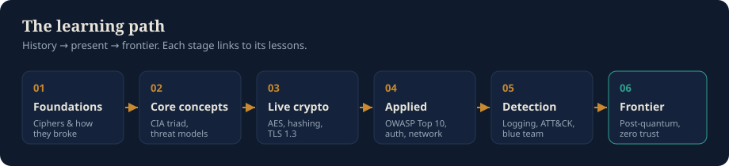
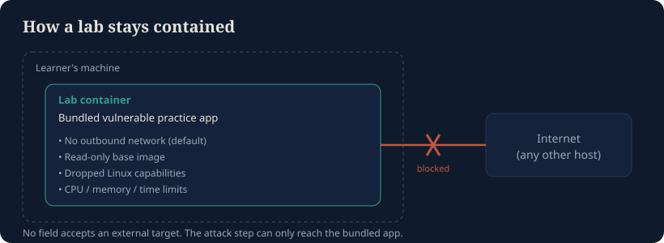
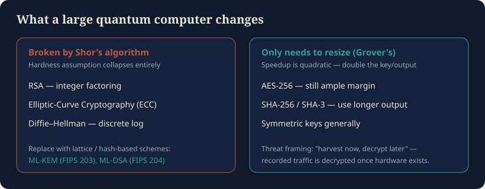

# Bulwark

**An open-source cybersecurity learning platform that teaches security by walking its whole arc — from the classical ciphers and how they fell, through the cryptography that runs the internet today, to the post-quantum frontier.**

> *Working name: "Bulwark" — a defensive wall. Rename freely; the name lives only in `index.html` `<title>`, the README, and `docs/`.*

Bulwark is a **defensive education tool.** It explains how attacks work — at a conceptual, historical, and hands-on level — so learners can *defend* against them. It ships no working exploits, malware, or step-by-step instructions for attacking systems the learner doesn't own. Every hands-on lab runs against a bundled, intentionally vulnerable practice target the learner controls. Where a topic could cause real harm, Bulwark teaches the defense and the detection, not a runnable weapon. See [`docs/ETHICS.md`](docs/ETHICS.md).

The web app is fully static and runs client-side, so it deploys to GitHub Pages with no backend and no data leaving the browser.

---

## What's in this milestone (MVP)

This repository is **milestone 1** of the [roadmap](#roadmap): the timeline spine, the foundational lessons, the two flagship widgets, the first attack-then-defend lab simulations, the sources page, and the security/ethics scaffolding.

| Area | Status |
|---|---|
| History → frontier timeline spine (the hero) | ✅ Built |
| Lessons: classical ciphers, CIA triad, hashing, injection & untrusted input | ✅ Built |
| Lessons: public-key crypto, TLS 1.3 handshake, OWASP Top 10 (2025), authentication, post-quantum frontier | ✅ Built |
| Lessons: threat modeling (STRIDE), detection & response (assume breach), zero trust & confidential computing | ✅ Built |
| Lessons: tokens/sessions & OAuth 2.0, securing AI systems (OWASP LLM Top 10) | ✅ Built |
| Lessons: quantum cryptography (BB84 / QKD) | ✅ Built |
| Lessons: steganography (LSB image hiding), software supply-chain security (OWASP A03) | ✅ Built |
| Command-injection simulation; TLS 1.3 **byte-level** ClientHello walkthrough | ✅ Built |
| JWT inspector (real HMAC verify), OAuth/PKCE flow, prompt-injection sim, token-bucket rate limiter, CSP builder | ✅ Built |
| BB84 quantum key distribution simulator (with detectable eavesdropper) | ✅ Built |
| Image steganography lab, certificate-chain visualizer, supply-chain dependency-risk explorer | ✅ Built |
| Defensive **Challenges** (capture-the-flag puzzles) with scoring + saved progress; animated hero | ✅ Built |
| Per-lesson knowledge-check quizzes; searchable glossary; progress tracking; lesson search | ✅ Built |
| Cipher playground + live frequency-analysis break | ✅ Built |
| Hash avalanche (SHA-256 via Web Crypto) | ✅ Built |
| SQL-injection simulation (vulnerable → parameterized), in-browser | ✅ Built |
| Cross-Site Scripting (XSS) demo in a sandboxed `iframe` (vulnerable → encoded) | ✅ Built |
| DDoS **concept** visualizer (amplification math + defense-in-depth) — no traffic generated | ✅ Built |
| Diffie–Hellman, elliptic-curve point addition, password entropy, TLS handshake stepper, OWASP accordion, post-quantum toggle, trust-boundary canvas, ATT&CK explorer | ✅ Built |
| Sources page with "last verified" dates | ✅ Built |
| Worked-example verification in `tests/` (ciphers, SHA-256, RSA, Diffie–Hellman, elliptic curves, entropy) | ✅ Built |
| Strict Content Security Policy, no analytics, state in `localStorage` | ✅ Built |
| Lesson: **storing secrets** — Argon2id/bcrypt/scrypt/PBKDF2, envelope encryption + KMS/HSM, secret managers, rotation, secrets out of git, client-side storage | ✅ Built |
| Widgets: live PBKDF2 cost timer, real Web Crypto envelope encryption with KEK rotation, pre-commit secret scanner | ✅ Built |
| Hacksplaining-style step-by-step **walkthroughs**: CSRF + SameSite, clickjacking + frame-ancestors | ✅ Built |
| **API security** era: OWASP API Top 10 (2023) with an in-page API gateway control board; testing your own app with automated/AI pentesters | ✅ Built |
| Secure **code review** exercise, port-scanning **exposure** visualizer, session fixation + open redirect walkthroughs, home **learning-path map**, 17 CTF challenges | ✅ Built |
| CI: SHA-pinned Actions, CodeQL, gitleaks, weekly link check, Dependabot, render smoke test | ✅ Built |
| Sandboxed container lab runner, downloadable desktop app | ⏭️ Later milestones |

The runnable, containerized labs described in [`docs/LABS.md`](docs/LABS.md) belong to milestone 3 — they need an isolated container/desktop runner that a static site can't provide. What ships here are the **client-side simulations** of those same lessons: safe by construction (a fake in-memory database, a sandboxed iframe, a math widget), teaching the identical attack→defend arc with nothing that works outside the page.

---

## Run it

It's a static site. Any static server works; a secure context (`https://` or `http://localhost`) is required for the hash widget, because the Web Crypto API (`crypto.subtle`) is disabled on `file://`.

```bash
# from the repo root
python3 -m http.server 8000
# then open http://localhost:8000
```

Deploy: push to GitHub and enable **Settings → Pages → Deploy from branch** (root). No build step. Full copy-paste terminal commands, from a blank Ubuntu machine through `git push` and enabling Pages, are in [`docs/DEPLOY.md`](docs/DEPLOY.md).

---

## How it's organized

```
index.html            # single-page app shell; strict CSP; no inline scripts
css/styles.css        # all styling; light + dark themes via tokens
js/
  content.js          # the curriculum as data: eras, lessons, sources
  app.js              # hash router, safe content renderer, widget mounting
  widgets/
    cipher.js         # Caesar/Vigenère playground + frequency-analysis break
    hash.js           # SHA-256 avalanche visualizer
    sqli.js           # SQL-injection simulation (in-memory, fake DB)
    xss.js            # XSS demo in a sandboxed iframe
    ddos.js           # amplification-factor + defense-in-depth concept viz
    diffie-hellman.js # interactive shared-secret key exchange
    eccurve.js        # elliptic-curve point addition (canvas)
    entropy.js        # password entropy + time-to-guess
    tls.js            # TLS 1.3 handshake stepper
    owasp.js          # OWASP Top 10 (2025) accordion
    pqc.js            # post-quantum "what breaks" toggle
    walkthrough.js    # step-by-step attack → defense stories (data-driven)
    apidefense.js     # API gateway control board (OWASP API Top 10)
    kdf.js            # fast hash vs. slow salted KDF, timed live
    envelope.js       # envelope encryption + KEK rotation (Web Crypto)
    secretscan.js     # toy pre-commit secret scanner
    codereview.js     # spot the flawed line, pick the fix
    exposure.js       # what a port scan would see + firewall log
    threatmodel.js    # trust-boundary canvas (STRIDE)
    attack.js         # MITRE ATT&CK explorer (teaching subset)
    tlsbytes.js       # byte-level annotated ClientHello
    cmdi.js           # command-injection simulation
    quiz.js           # per-lesson knowledge check
    jwt.js            # JSON Web Token inspector + HMAC verify
    oauth.js          # OAuth 2.0 + PKCE flow stepper
    promptinject.js   # LLM prompt-injection simulation
    ratelimit.js      # token-bucket rate limiter
    cspbuilder.js     # Content Security Policy builder
    bb84.js           # BB84 quantum key distribution simulator
    heroanim.js       # animated decoder effect for the hero
    challenge.js      # capture-the-flag challenge runner + scoring
    stego.js          # LSB image steganography lab
    certchain.js      # TLS certificate chain-of-trust visualizer
    depgraph.js       # software supply-chain risk explorer
xss-sandbox.html      # isolated page the XSS widget loads under a strict CSP
tests/                # worked-example verification (node --test)
docs/
  ETHICS.md           # responsible-use policy and the hard lines
  SECURITY.md         # vulnerability reporting + the app's own security posture
  LABS.md             # the attack→defend lab track design (all tracks)
  assets/             # README diagrams (SVG)
.github/workflows/    # CI: run tests, check links
```

**Content is data.** Lessons live in `js/content.js` as structured objects, not hand-written HTML. `app.js` renders them through a small inline-markup function that escapes every string first, then applies a fixed whitelist (`**bold**`, `` `code` ``, links with a validated scheme). User input in the widgets is *always* inserted with `textContent` — never `innerHTML`, never `eval`. That rule is the subject of one of the lessons, so the code models it.

---

## The learning path



## How the (future) labs stay contained

Every offensive step is confined to a target the learner started, on their own machine, that talks to nothing else. In the MVP that containment is trivial — the "database" is a JavaScript array and the "victim page" is a sandboxed iframe. The containerized runner in milestone 3 enforces the same rule at the OS level:



## What a quantum computer changes



---

## Accuracy

Every non-obvious claim is cited to a primary source (NIST FIPS, IETF RFCs, OWASP, MITRE, peer-reviewed papers) on the **Sources** page, each with a "last verified" date, because the fast-moving parts (post-quantum standards, the OWASP list version) change. A few facts baked in as of the last review:

- **OWASP Top 10:2025** was released **2025-11-06**, adding *A03 Software Supply Chain Failures* and *A10 Mishandling of Exceptional Conditions*; Broken Access Control remains #1.
- **NIST post-quantum standards**: ML-KEM (FIPS 203), ML-DSA (FIPS 204), SLH-DSA (FIPS 205) finalized **2024-08-13**; HQC selected as a backup KEM in **March 2025**; FN-DSA (FIPS 206) still in draft.

**Cryptography rule for this repo:** teach with vetted libraries; never present hand-rolled crypto as production-ready. The widgets implement classical ciphers and call the platform's audited `crypto.subtle` for real hashing — and every crypto page says so.

---

## Roadmap

1. **MVP (this milestone):** timeline spine, foundations + cryptography lessons, cipher playground + hash avalanche, injection simulations, sources page.
2. TLS 1.3 byte-walkthrough; public-key and elliptic-curve visualizations; OWASP Top 10 lessons.
3. Sandboxed labs (defensive capture-the-flag) with the isolated container runner; ATT&CK explorer; detection & response track.
4. Post-quantum and frontier track; downloadable desktop app with offline labs; signed releases.
5. Hardening: reviewer pass on accuracy and citations; security review of the sandbox; ethics review of every lab to confirm nothing ships as a reusable weapon.

## Contributing

Read [`docs/ETHICS.md`](docs/ETHICS.md) first — contributions that add runnable offensive tooling are out of scope by policy, not by oversight. Vulnerability reports go through [`docs/SECURITY.md`](docs/SECURITY.md). Teaching resources and practice platforms that inspired this project are credited in [`docs/REFERENCES.md`](docs/REFERENCES.md).

## License

[MIT](LICENSE). Reference projects studied for teaching style are credited on the Sources page; honor their licenses when borrowing.
